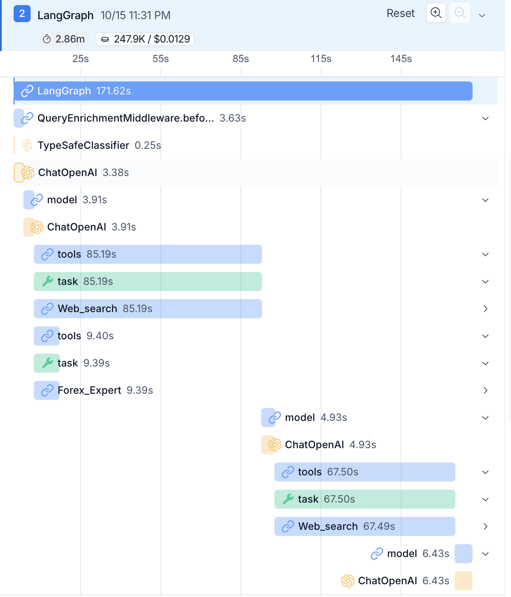

<p align="center">
  
</p>

<h1 align="center">Jever</h1>

<p align="center">
  <em>Exploring how <strong>Jev</strong> can be used with agents: a fast classifier that triages every message before your supervisor agent sees it.</em>
</p>

<p align="center">
  
  
  
</p>

---

## What is this?

Agents are great at hard questions and a little overkill for easy ones. Jever puts **Jev**, TypeSafe's small, fast classifier model, in front of a **supervisor agent** as middleware, like a concierge at the front desk. Before the supervisor does anything, Jev decides what to do with the message:

| Label | Meaning | What the middleware does |
|---|---|---|
| `direct` | Clear, single question | Passes it straight through |
| `decomposable` | Several distinct questions in one | Splits it up and tells the supervisor to fan out to subagents |
| `enrichable` | Understandable, but sloppy | Rewrites it to be clearer |
| `needs_clarification` | Missing information only the user has | Tells the supervisor to ask the user |

The middleware only acts when Jev is at least **80%** confident (configurable via `threshold`). Below that, the message goes through untouched.

## Architecture

```
User ──► QueryEnrichmentMiddleware (Jev) ──► Supervisor agent ──┬──► Forex_Expert  (Frankfurter API)
                                                                └──► Web_search    (Tavily)
```

- **Supervisor:** built with LangChain's `create_agent`, with no tools of its own. It can only delegate.
- **Subagents:** `Forex_Expert` (live exchange rates) and `Web_search` (Tavily), wired in through `SubAgentMiddleware` from [Deep Agents](https://github.com/langchain-ai/deepagents).
- **Memory:** a SQLite checkpointer saves conversations to `jever.db`.
- **Observability:** runs are traced in LangSmith.

## Getting started

### Prerequisites

- Python 3.14+
- [uv](https://docs.astral.sh/uv/)
- API keys for [OpenAI](https://platform.openai.com/), [Tavily](https://tavily.com/), [TypeSafe](https://typesafe.ai/) and [LangSmith](https://smith.langchain.com/)

### Install

```bash
git clone <your-repo-url> jever
cd jever
uv sync
```

### Configure

```bash
cp .env.example .env
```

Then fill in your keys:

```env
OPENAI_API_KEY=...
TAVILY_API_KEY=...
TYPESAFE_API_KEY=...
LANGSMITH_API_KEY=...
LANGSMITH_TRACING=true
LANGSMITH_PROJECT=jever
```

### Run

Open the walkthrough notebook and run it top to bottom:

```bash
uv run jupyter lab notebooks/agent.ipynb
```

(or open [notebooks/agent.ipynb](notebooks/agent.ipynb) in VS Code and pick the `.venv` kernel).

## What's in the notebook

1. Two tools: web search (Tavily) and live forex rates (Frankfurter)
2. The Jev-powered `QueryEnrichmentMiddleware`
3. A supervisor that delegates to two subagents
4. Test queries for each label, plus a look at the LangSmith traces

## Findings

<p align="center">
  
</p>

- **Jev decides *how* a question gets handed off.** Reasoning, fact-checking and the final write-up stay with the supervisor LLM. Put Jev **in front of** the supervisor, not in place of it.
- **The confidence gate matters.** On a messy Singlish query, Jev's top label had only 43% confidence, so the 80% gate stood down and the supervisor never got a cleaned-up question. Pick your threshold on purpose and test it with messy, real-world inputs.
- **Fan-out isn't free.** The decomposed run took about 2.9 minutes and about 248K tokens, partly because the supervisor re-verified a claim with an extra web search.

## Project layout

```
.
├── notebooks/agent.ipynb   # End-to-end walkthrough
├── images/                 # Logo and LangSmith trace screenshots
├── pyproject.toml          # Dependencies (managed with uv)
└── .env.example            # Required environment variables
```

## License

Released under the [MIT License](LICENSE).
